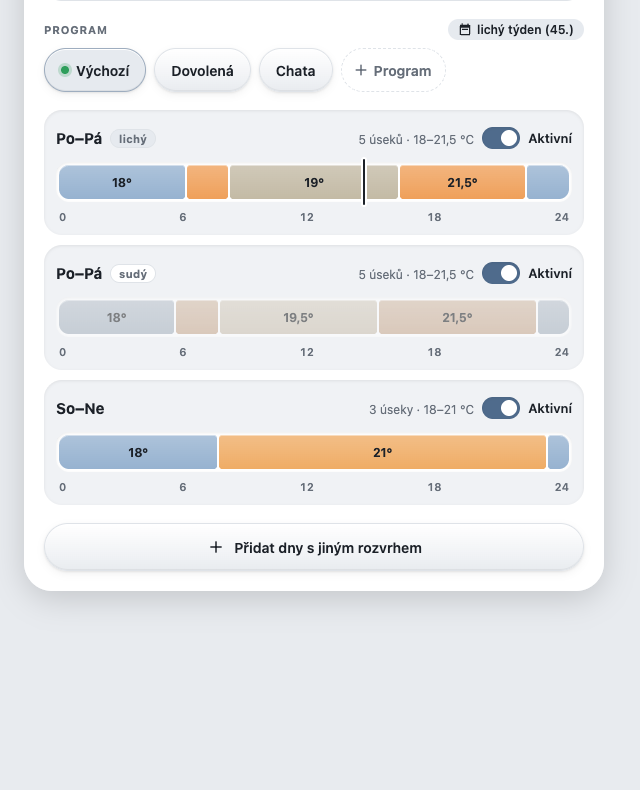
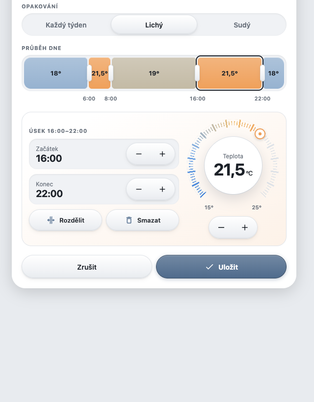
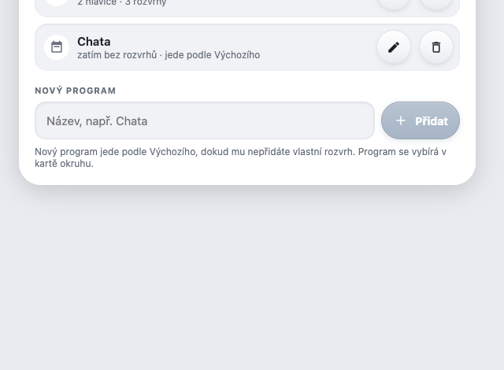
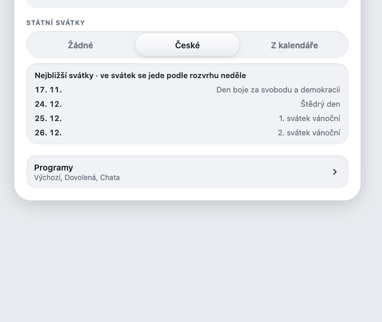
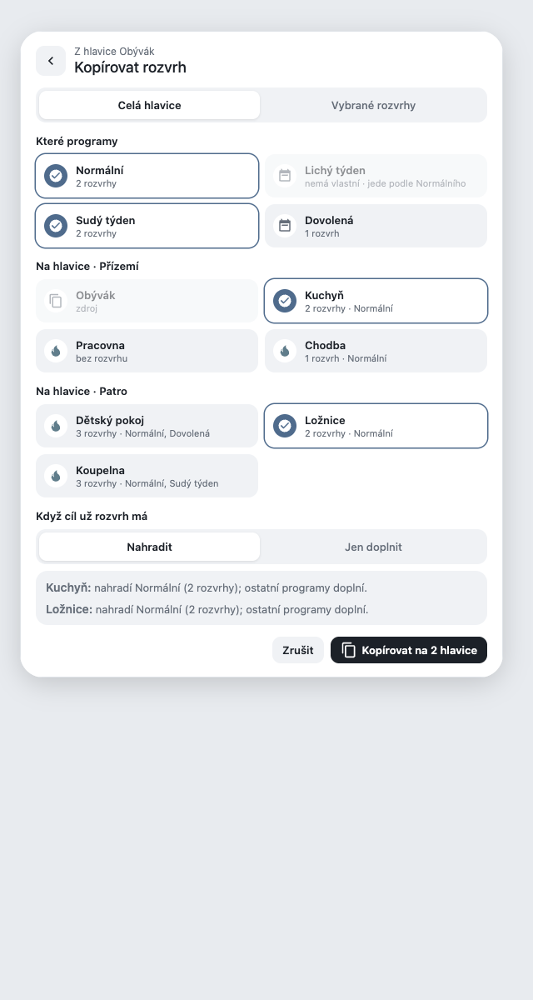

# Heating Schedule Card

A Home Assistant card for the weekly heating schedules of climate valves, written in Czech. Schedules are stored by [scheduler-component](https://github.com/nielsfaber/scheduler-component) (no own integration); the card reads them, shows what a valve does now and writes `scheduler/add`, `edit` and `remove`. The schedule switches stay **off**: the heating automation alone decides what a valve gets.

## Features

- **Week view**: a "now" tile (current setpoint, next change, the state the heating automation reports), program chips, one temperature-coloured 24 h bar per weekday group, and a per-schedule "Aktivní" pause.
- **Editor**: weekdays, a 24 h bar with selectable slots, start / end +/- `time_step`, split / delete a slot, a Bento dial in 0.5 degree steps. A card without `valve` first asks for which valves a new schedule is made.
- **Copy to other valves**: a whole valve or selected schedules, Nahradit / Jen doplnit, with a per-valve preview.
- **Programs**: a dashed `+ Program` chip and a *Programy* view (also from the settings): add, rename and delete programs of the circuit.
- **Odd / even weeks**: a schedule can apply every week, only in odd weeks, or only in even weeks (tabs *Každý týden / Lichý / Sudý* in the editor while the alternation is on); the week view shows the current week and dims the rows of the other one. Day presets *Pracovní dny / Víkend / Každý den* in the editor.
- **Public holidays**: a holiday runs by the Sunday schedule (Czech holidays built in, or any calendar of HA's Holiday integration); the settings list the next ones.







## Installation

Not in HACS. Copy [`dist/heating-schedule-card.js`](dist/heating-schedule-card.js) to `config/www/`, then add a dashboard resource:

Settings → Dashboards → ⋮ → Resources → Add resource → URL `/local/heating-schedule-card.js?v=0.2.0`, type **JavaScript module** → reload the browser. Change `?v=` after copying a new version.

## Configuration

```yaml
type: custom:heating-schedule-card
valve: climate.obyvak_valve        # optional: preselected valve (configured or discovered); none = the first valve of the first circuit
circuits:                           # required: configured circuits; every other heating circuit in the states is added automatically
  - id: heating_circuit_1           # heating instance = area id; entity ids derive from it
    name: Přízemí                   # optional: default = attribute `title` of binary_sensor.heating_state_<id>, else the id
    valves: [climate.obyvak_valve, climate.kuchyn_valve]
time_step: 15                       # optional, minutes (divisor of 1440)
```

Circuits are discovered: every `sensor.heating_schedule_<id>` with a `targets` attribute adds a circuit (valves = the keys of `targets`, name = `title` of `binary_sensor.heating_state_<id>`), so the valve picker and the copy view reach all heating circuits. `circuits` in the config only adds or names circuits; a configured id wins, and a valve stays in the first circuit that lists it.

## How it works with the heating feature

The card only stores schedules in scheduler-component; it never controls a valve itself.

- The schedule switches stay **off** (the heating feature keeps them off). Node-RED reads the schedules and applies the slots to the valves at every slot start, so the scheduler never fires.
- **Programs** come from the heating feature's `programs` parameter (`sensor.heating_program_<circuit>`: `programs` and `program_names`); Výchozí (`auto`) is always first. The chips show them, a schedule's program is its tag `program:<id>` (none = `auto`).
- **Fallback**: a program with no schedule for a weekday uses the Výchozí schedule of that day, per day (same rules as the heating feature's `heating_slot_temp`). A program without schedules shows "používá výchozí rozvrh" and can be given its own copy of the Výchozí schedules.
- **Weeks**: the tag `week:odd` / `week:even` (none = every week) limits a schedule to odd / even weeks. The weeks alternate strictly every 7 days, counted from Monday 2025-12-29 = odd (the heating's `heating_week_parity`; never ISO week % 2, because 2026 has ISO week 53), the badge shows that parity with the ISO number. The per-day fallback and the carry-over from the previous day use the week of the day they look at. Odd and even schedules of the same weekdays never conflict; a schedule without a tag conflicts with both. A copy keeps the tag.
- **Holidays**: with *Státní svátky* set to *České* (built in, `czechHolidays`) or *Z kalendáře* (the dates the heating imported into `sensor.heating_programs_<circuit>`), a holiday counts as Sunday, as in the heating's `heating_slot_temp`. The now tile says *Svátek · podle neděle*.
- **Pause**: the tag `paused` (the "Aktivní" toggle) removes a schedule from the heating without deleting it.
- **Copy** writes new schedules for the target valves, tagged with the same program; a target valve whose circuit lacks the program is skipped.
- A schedule the card cannot represent (not `repeat`, conditions, other actions, several valves, sun times, gaps) is shown read-only and never written.

### What the card writes besides schedules

Needs heating 1.9.0 or newer (programs, weeks and holidays, #352). All helpers belong to the circuit (`<circuit>` = the heating instance):

| Action | Call |
| --- | --- |
| Add / rename / delete a program | `script.heating_programs_set_<circuit>` with `programs` = the whole list `[{id, name}]` without Výchozí; read back from `sensor.heating_programs_<circuit>` attribute `programs`. The id is a slug of the name (ASCII lower-case, `_`); `auto` and the name *Výchozí* are reserved, a used name or id is refused before writing. Deleting a program first removes its schedules on the circuit's valves (a read-only one blocks it; a failure puts the removed ones back), then the list entry. |
| Střídat lichý a sudý týden | `input_boolean.toggle` on `input_boolean.heating_week_alternation_<circuit>` (it only shows the week controls; the tags always count) |
| Státní svátky | `input_select.select_option` (`none` / `cz` / `calendar`) on `input_select.heating_holidays_<circuit>` |
| Kalendář svátků | `input_text.set_value` on `input_text.heating_holiday_calendar_<circuit>` (a `calendar.*` entity); the holiday names of a calendar are fetched with `calendar.get_events`, best effort |

The settings list the next holidays from `sensor.heating_schedule_<circuit>` attribute `holidays_next`.

One scheduler-component schedule = one program's weekdays with timeslots covering 00:00-24:00, one `climate.set_temperature` action each.

## Events

- `hsc-edit` (`detail: {valve, program, schedule | null}`, cancelable): a row or "Přidat dny s jiným rozvrhem" was tapped; the card opens its editor unless a listener calls `preventDefault()`.
- `hsc-copy` (`detail: {valve, program, schedule | null}`, cancelable): the copy button of the week header or of the editor; the card opens its copy view unless a listener calls `preventDefault()`. Only editable, non-paused schedules of the source valve are copied; a target valve whose circuit lacks the target program is skipped.

## Tests

Pure functions are exported from the module:

```sh
node --test tests/*.test.mjs
```

Browser check with a fake `hass` (`tests/fixtures/schedules.json` = real items from the dev HA). Screenshots of the canvas layouts with a fixed clock: `tests/dom.html?shot=week|fallback|states|editor|picker|copy-valve|copy-one|week3|editor3|programs|settings` (`settings` + `&cal=1` = calendar mode) (`&dark=1`, `&w=390`).

```sh
python3 -m http.server 8765 &
"Google Chrome" --headless=new --virtual-time-budget=5000 --dump-dom http://localhost:8765/tests/dom.html | grep RESULT
```

## Licence

MIT
